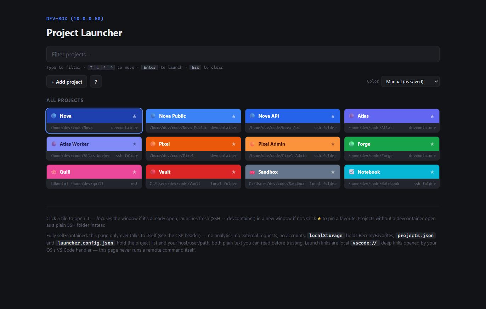
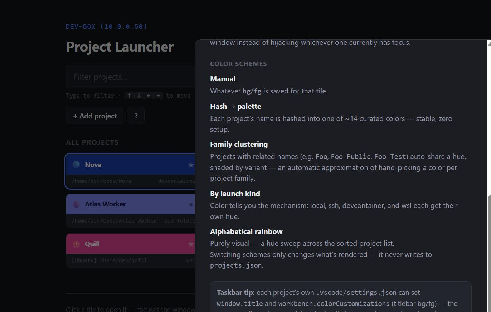

# Docking Bay

A keyboard-driven, colorful tile launcher for VS Code. Click (or type-and-`Enter`) a
tile and it opens that project in VS Code — local folder, SSH folder, an SSH
devcontainer, or WSL — always in its own fresh window, never hijacking whichever
window currently has focus.

It's a single static page you open straight from disk. No server, no build step,
no backend, no account, no telemetry. Everything it knows lives in two small data
files you can read in a text editor.



*(sample data shown — your own grid is whatever you put in `projects.js`)*

## Why

If you juggle a lot of projects across a lot of remote hosts and devcontainers,
`code --folder-uri` and VS Code's own "Open Recent" menu stop being fast past a
certain number of projects. This is a Rolodex for that: type a few letters, hit
Enter, you're in.

## Features

- **Keyboard-first** — autofocused search filters as you type; arrow keys move a
  grid-aware selection; `Enter` launches; `Esc` clears.
- **Four launch kinds** — local folder, plain SSH folder, SSH devcontainer, or WSL.
  Add any of them through the in-app form, no JSON editing required.
- **Always a fresh window** — every generated link carries `?windowId=_blank`, so
  clicking a tile never steals focus from — or replaces — whatever window you're
  already in.
- **Five color schemes**, switchable live from the toolbar: your own hand-picked
  colors, a deterministic hash-to-palette scheme, automatic "family" clustering by
  name (`Foo`, `Foo_Public`, `Foo_Test` share a hue), color-by-launch-kind, or a
  pure alphabetical rainbow. Purely a view — never rewrites your data file.
- **Project discovery** — list the places your projects live (an SSH host, a WSL
  distro, a local folder) and **Rescan** finds them: from the button (with the optional
  helper), by running one script, at logon, or on a timer. It never clobbers anything you've hand-edited.
- **No server** — the page runs from a `file://` path. The install script adds a
  desktop shortcut that opens it in its own app window.
- **In-app help** — a `?` button opens a reference for shortcuts, launch kinds, and
  color schemes without leaving the page.

  
- **Self-contained and inspectable** — a strict Content-Security-Policy means the
  page literally cannot make a network request. Read `launcher.config.js` and
  `projects.js` yourself before trusting them; there's nothing else to trust.

## Quick start

Open `project-launcher.html` in a browser. That's the whole launcher — it works on
any OS with nothing installed.

On Windows, run the one-time setup (PowerShell 7, no admin needed) to get the
desktop shortcut and project discovery:

```powershell
# from the repo root
pwsh scripts/install-launcher.ps1
```

For the current user only, this:

- adds a **Docking Bay** desktop shortcut that opens the page in its own Edge/Chrome
  app window (pin it to the taskbar from there),
- adds a Startup shortcut that rescans at logon (`-EveryMinutes 60` also rescans on
  a timer), and
- runs a first scan.

`pwsh scripts/install-launcher.ps1 -Uninstall` removes all of it again.

### One-click Rescan: the optional Node helper

The page only reads files, so on its own the **Rescan** button can't start a scan: it
shows the command to run (`pwsh scripts/refresh-projects.ps1`) with a Copy button,
and the page reloads when you come back to it after the scan finishes.

If you'd rather have a real button, install the helper (needs Node 18+, no
`npm install`):

```powershell
pwsh scripts/install-launcher.ps1 -NodeHelper            # add -EveryMinutes 60 to rescan hourly
```

That adds a Startup shortcut for `helper/server.js` and starts it now. It listens on
`127.0.0.1:47613` only, runs the same scan (a Node port of the PowerShell one, so
it works without PowerShell), and replaces the PowerShell logon/timer scan. You can
also run it by hand on any OS: `node helper/server.js` (add `--every 60`), or
`node helper/server.js --once` for a single scan from the command line.

**Upgrading from the old server-based version?** Uninstall the old "Docking Bay"
app from Edge/Chrome first (otherwise its cached copy keeps opening), then run the
install script: it converts an existing `projects.json` / `launcher.config.json`
to the new `.js` files and keeps the originals as `.json.bak`. Favorites, Recent
and tiles added through the in-app form were stored by the browser under the old
`localhost` address and don't carry over.

## Adding a project

Click **+ Add project** and pick a kind:

| Kind | What it needs | Resulting link |
|---|---|---|
| Local folder | An absolute path on this machine | `vscode://file/<path>/` |
| SSH folder | A profile (see below) + remote path | `vscode://vscode-remote/ssh-remote+…` |
| SSH devcontainer | A profile + the folder's host path | `vscode://vscode-remote/dev-container+…` |
| WSL | Distro name + path inside it | `vscode://vscode-remote/wsl+<distro>/…` |

Projects added this way are saved to your browser's `localStorage` — they never
touch `projects.js` on disk, so there's nothing to accidentally commit.

## Configuration

Both data files are JSON wrapped in a single assignment, so the page can load them
with a plain `<script>` tag (browsers won't let a page opened from disk read a
`.json` file).

**`launcher.config.js`** defines reusable SSH connection profiles and where to look
for projects:

```js
window.DOCKING_BAY_CONFIG = {
  "profiles": [
    { "id": "dev-box", "label": "dev-box (10.0.0.50)", "sshHost": "10.0.0.50", "sshUser": "me" }
  ],
  "scans": [
    { "kind": "ssh",   "profile": "dev-box", "path": "/home/me/code" },
    { "kind": "local", "path": "C:/Users/me/code" },
    { "kind": "wsl",   "distro": "Ubuntu", "path": "/home/me/code" }
  ]
};
```

**`projects.js`** is the tile list. Each entry:

```js
window.DOCKING_BAY_PROJECTS = [
  {
    "p": "my-project",
    "t": "My Project",
    "e": "🔵",
    "bg": "#3B82F6",
    "fg": "#FFFFFF",
    "target": { "kind": "ssh-devcontainer", "profile": "dev-box", "hostPath": "/home/me/code/my-project", "workspaceFolder": "/workspace" }
  }
];
```

Edit them by hand and reload the page, or let Rescan maintain `projects.js` for you.

### Discovering projects

Each entry under `scans` is one folder to look in. A scan lists that folder's
immediate subfolders and makes a tile for each:

| Kind | Needs | How it scans | Tiles it creates |
|---|---|---|---|
| `ssh` | `profile`, `path` | SSHes in with your existing key and runs one fixed, read-only script | SSH devcontainer if the folder has a `.devcontainer/devcontainer.json`, otherwise SSH folder |
| `local` | `path` | Reads the folder on this machine directly | Local folder |
| `wsl` | `distro`, `path` | Runs the same read-only script inside the distro | WSL |

Add as many as you like, including several paths on the same host. (A `basePath`
on a profile, from older configs, still counts as an `ssh` scan of that path.)

Trigger a scan with the **Rescan** button (`Alt`+`R`; one click with the helper, otherwise it shows the command), or directly:

```powershell
pwsh scripts/refresh-projects.ps1
```

It merges non-destructively:

- new folders are added and flagged `_review` (pick an emoji and title),
- folders that disappeared are flagged `_missing` rather than deleted,
- titlebar colors already set in a project's `.vscode/settings.json` are synced, and
- emoji, titles and hand-added entries outside the scanned folders are never touched.

A location that can't be reached (host down, key needs a passphrase) is reported
under the Rescan button and skipped; its tiles are left exactly as they were. SSH
runs non-interactively, so the key has to work without a prompt — load it into
`ssh-agent` if it has a passphrase. If the same folder name exists in two scanned
locations, the second tile's id gets the source appended (`Nova@local`).

## The taskbar trick

The tile color and emoji you see here are meant to travel with the project, not
just live in this launcher. Set the same emoji + color as a `window.title` and
`workbench.colorCustomizations` in a project's own `.vscode/settings.json`:

```json
{
  "window.title": "🔵 My Project",
  "workbench.colorCustomizations": {
    "titleBar.activeBackground": "#3B82F6",
    "titleBar.activeForeground": "#FFFFFF"
  }
}
```

Do that consistently and every open VS Code window carries its own emoji + color
into the Windows taskbar and Alt-Tab switcher — so once this launcher gets you into
five projects at once, telling them apart again is just as fast:

*(screenshot coming soon — a taskbar with several color-coded VS Code windows open)*

## How it stays safe to hand to a stranger

- No server and no open port by default — the page is a file on disk. The optional
  helper is the one exception, and it listens on `127.0.0.1` only.
- `default-src 'none'` CSP — the page cannot fetch, post, or load anything beyond
  its own script files, apart from `connect-src http://127.0.0.1:47613`, which is
  the helper and nothing else.
- No `innerHTML` on anything data-derived — everything is built with
  `textContent`/`createElement`.
- Scanning only ever runs one fixed, read-only script; folder names it discovers
  are treated strictly as data, never re-interpolated into a shell command.
- The helper exposes only `GET /status` and `POST /rescan`. `/rescan` takes no input
  and runs the fixed scan, so the worst a stray request can do is start a scan. It
  rejects any `Host` other than `127.0.0.1`/`localhost` (DNS rebinding), any `Origin`
  other than the `null` a page opened from disk sends, and requests without its
  custom `X-Docking-Bay` header.
- No custom URL protocol is registered. (Earlier versions registered `dockingbay://`,
  which made the browser launch a hidden PowerShell and was flagged by security
  software. The installer now removes it.)
- Nothing is sent anywhere. `localStorage` is the only browser state, and it never
  leaves your browser profile.
- The install script touches only your own user profile (one registry key under
  `HKCU`, two shortcuts, optionally one scheduled task) and `-Uninstall` removes it.

## Files

| File | Purpose |
|---|---|
| `project-launcher.html` / `project-launcher.js` | The app |
| `launcher.config.js` | SSH profiles and scan locations |
| `projects.js` | The tile list |
| `scan-status.js` | Written by each scan (when, what changed); not committed |
| `launcher-icon.svg` / `launcher-icon.ico` | Page and shortcut icon |
| `scripts/install-launcher.ps1` | One-time Windows setup: shortcut, logon scan, optional `-NodeHelper` |
| `scripts/refresh-projects.ps1` | The scan itself (PowerShell) |
| `helper/server.js` | Optional local service behind the one-click Rescan button; also `--once` |
| `helper/scan.js`, `helper/data.js`, `helper/scan-remote.sh` | The same scan, ported to Node (keep in step with `refresh-projects.ps1`) |
| `scripts/launcher-data.ps1` | Shared helpers for reading/writing the data files |
